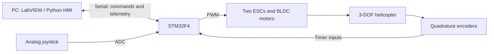

# Hardware and communication architecture

For **exact component specifications and wiring**, see [component inventory](COMPONENTS_AND_SPECIFICATIONS.md) and [detailed signal/terminal mapping and wiring schematic](WIRING_SCHEMATIC.md).

This document describes the project's specific experimental hardware configuration. It is **not** a ready-to-flash safety-validated implementation.

## System overview

## STM32 pin mapping from the project firmware

| Function | Pins | Peripheral |
| --- | --- | --- |
| Motor 1 ESC PWM | `PA8` | `TIM1_CH1` |
| Motor 2 ESC PWM | `PA10` | `TIM1_CH3` |
| Pitch encoder | `PA1`, `PA5` | `TIM2` |
| Elevation encoder | `PA6`, `PA7` | `TIM3` |
| Travel encoder | `PD12`, `PD13` | `TIM4` |
| UART TX/RX | `PA2`, `PA3` | `USART2` |
| Joystick X/Y | `PB0`, `PB1` | ADC inputs |

The archived firmware reports **pitch, travel, elevation, joyY, joyX** as comma-separated serial telemetry. The host controller sends motor commands as `pwm1,pwm2`.

## Integration considerations

- Firmware measurement updates and host control-loop timing may differ between program versions. Confirm the effective rates on hardware.
- Verify UART baud rate against the STM32 peripheral clocks rather than relying on a hardcoded register value.
- Confirm the ESC arming sequence, PWM limits, encoder directions, rotor clearance, power wiring and emergency-stop behavior before experiments.
- Do not assume a verified loss-of-communication shutdown or fail-safe is present.

The implementation files are being reviewed prior to publication.
