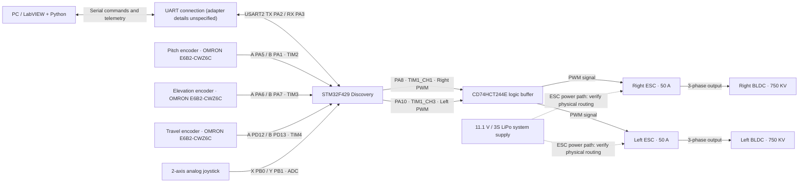

# Wiring schematic and connection pinout

**Source:** Co-authored master's thesis, Chapter 3, **Tables 3.1–3.4**; `helicopter_stm32_full.ino`. This page documents the **real project's reported connections**. The Mermaid chart is a **functional wiring overview**, not a complete manufacturer-approved electrical schematic, PCB netlist or safe assembly instruction.

## System wiring overview

**Mechanical routing:** The thesis documents a **slip ring** between the stationary structure and rotating arm. Wires for power and signals are routed through it to the interface board. This overview **does not identify individual slip-ring conductors**.

## STM32F429 Discovery signal mapping

| Signal | Controller pin | Peripheral / use | Notes |
| --- | --- | --- | --- |
| Right ESC PWM | `PA8` | `TIM1_CH1` | Through CD74HCT244E buffer; mapped as motor 1 in firmware |
| Left ESC PWM | `PA10` | `TIM1_CH3` | Through CD74HCT244E buffer; mapped as motor 2 |
| Pitch encoder output A | `PA5` | `TIM2_CH1` | Encoder 1000 P/R |
| Pitch encoder output B | `PA1` | `TIM2_CH2` | Encoder 1000 P/R |
| Elevation encoder output A | `PA6` | `TIM3_CH1` | Encoder 1000 P/R |
| Elevation encoder output B | `PA7` | `TIM3_CH2` | Encoder 1000 P/R |
| Travel encoder output A | `PD12` | `TIM4_CH1` | Encoder 1000 P/R |
| Travel encoder output B | `PD13` | `TIM4_CH2` | Encoder 1000 P/R |
| Joystick horizontal (X) | `PB0` | ADC | Joystick powered at 3.3 V |
| Joystick vertical (Y) | `PB1` | ADC | Joystick powered at 3.3 V |
| Serial TX to host | `PA2` | `USART2_TX` | Bridge to PC not specified |
| Serial RX from host | `PA3` | `USART2_RX` | Bridge to PC not specified |
| Encoder supply and reference | `5V`, `GND` | Supply / common ground | Actual signal voltage levels must be checked |
| Joystick supply and reference | `3.3V`, `GND` | Supply / common ground | Taken from thesis Table 3.4 |

The STM32 firmware implements encoder counting in hardware timer encoder mode, with a nominal `4000 counts/revolution` scaling assumption. The motor PWM waveform is **50 Hz** (20 ms period). The published firmware accepts host motor commands between **1000 and 1700 µs**.

## Custom interface-board connectors (thesis Table 3.1)

Position labels are from the thesis and run **left to right** as viewed in its specified board orientation. Do not infer orientation from an arbitrary photo.

### Connector 1 — right green terminal, 10 positions

| Position | Set | Thesis wire color | Documented function |
| --- | ---: | --- | --- |
| A | 2 | Blue | Elevation encoder — black wire |
| B | 2 | White | Elevation encoder — white wire |
| C | 2 | Blue | +Vcc |
| D | 2 | Grey | −Vcc |
| E | 3 | Black + red | ESC ground |
| F | 2 | Pink | Elevation encoder ground |
| G | 3 | Green | +Vcc |
| H | 3 | Brown | −Vcc |
| I | 3 | Orange | Right ESC control signal |
| J | 3 | Yellow | Left ESC control signal |

### Connector 2 — left green terminal, 10 positions

| Position | Set | Thesis wire color | Documented function |
| --- | ---: | --- | --- |
| A | 1 | Brown + orange | 5 V encoder supply |
| B | 1 | Red | Pitch encoder — black wire |
| C | 1 | Green | Pitch encoder — white wire |
| D | — | — | Unassigned in thesis |
| E | Own | Own | Travel encoder — black wire |
| F | Own | Own | Travel encoder — white wire |
| G–I | — | — | Unassigned in thesis |
| J | 1 | Black + own | Common ground for pitch and travel encoders |

### Connector 3 — middle green power terminal, 5 positions (thesis Table 3.2)

| Position | Set | Thesis wire color | Documented function |
| --- | ---: | --- | --- |
| A | 2 | Blue | +Vcc |
| B | 2 | Grey | −Vcc |
| C | — | — | Unassigned |
| D | 3 | Green | +Vcc |
| E | 3 | Brown | −Vcc |

**Documentation discrepancy to verify:** The thesis prose says Connector 3 power is shared with Connector 1 at spaces **A, B, D, E**, but the terminal *functions* in its Table 3.1 place the corresponding +Vcc/−Vcc wires at **C, D, G, H**. Treat the **physical power-terminal correspondence as unverified**, and do not wire a real board directly from this narrative without continuity testing.

## Central ribbon-cable header (thesis Table 3.3)

Two rows with ten positions each; only populated signals were listed.

| Row | Position | Documented signal |
| --- | ---: | --- |
| Upper | 1 | Pitch encoder A |
| Upper | 2 | Pitch encoder B |
| Upper | 4 | Travel encoder A |
| Upper | 5 | Travel encoder B |
| Lower | 1 | Encoder 5 V |
| Lower | 2 | Elevation encoder A |
| Lower | 4 | Elevation encoder B |
| Lower | 5 | Ground |
| Lower | 7 | Right motor red wire / PWM path |
| Lower | 8 | Left motor red wire / PWM path |

## Data link and practical limitations

- STM32 → host telemetry order in firmware: `pitch,travel,elevation,joystickY,joystickX`.
- Host → STM32 command format: `pwm1,pwm2\n` (microseconds).
- The firmware sends telemetry at **20 Hz**. Verify control-loop sampling compatibility with the host code.
- **Power-line protection, fuses, exact ESC input connector pinout, encoder output-level compatibility, emergency stop and watchdog behavior are not established by the existing documents**.
- The **CD74HCT244E is a logic buffer, not galvanic isolation**; electrical level compatibility should be checked against actual component datasheets.
- Do not apply 5 V or 11.1 V to an STM32 3.3 V GPIO without verifying pin tolerance and the circuit interface.
- The thesis supplies the part rating **50 A ESC**, but **not** its brand or specific part number; likewise motor manufacturer/model is unspecified beyond 750 KV.

## Related pages

- [Hardware components and specifications](COMPONENTS_AND_SPECIFICATIONS.md)
- [Hardware and data flow overview](HARDWARE_AND_DATAFLOW.md)
- [STM32 firmware](../firmware/stm32/helicopter_stm32_full/helicopter_stm32_full.ino)
